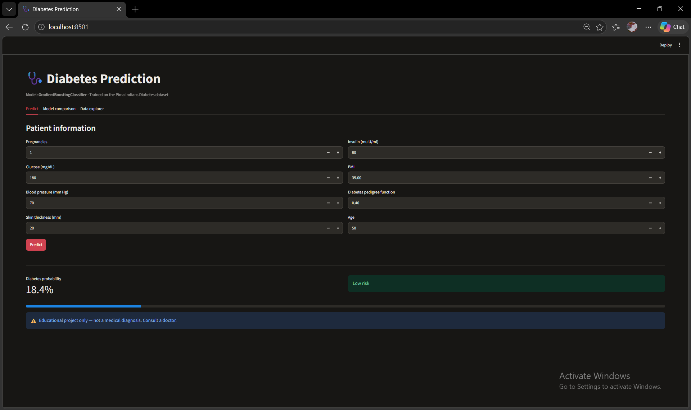

# 🩺 Diabetes Prediction

🔗 **Live demo:** https://https://diabetes-prediction-ikapp9xd8pqqjvappr6npys.streamlit.app/.streamlit.app

Machine learning project that predicts whether a patient is likely to have diabetes
from 8 medical features (Pima Indians Diabetes dataset), with an interactive **Streamlit** app.

## Features
- Data exploration (correlation, distributions, outliers)
- 4 models compared: Logistic Regression, SVC, Random Forest, Gradient Boosting
- Preprocessing pipeline: missing-value handling (0 → median) + scaling
- Metrics: Accuracy, Precision, Recall, F1, ROC-AUC
- Streamlit app: live prediction with risk level, model comparison, data explorer

## Project structure
```
├── app.py               # Streamlit app
├── train_model.py       # trains the models and saves the best one
├── requirements.txt
├── data/diabetes.csv    # dataset
├── models/              # saved model + metrics (generated)
└── notebook/            # original Colab notebook
```

## Run locally
```bash
pip install -r requirements.txt
python train_model.py
streamlit run app.py
```

## Results

| Model | Accuracy | Precision | Recall | F1 |
|---|---|---|---|---|
| Logistic Regression | 0.708 | 0.600 | 0.500 | 0.546 |
| SVC | 0.740 | 0.652 | 0.556 | 0.600 |
| Random Forest | 0.740 | 0.659 | 0.537 | 0.592 |
| **Gradient Boosting** | **0.760** | **0.667** | **0.630** | **0.648** |

Best model: **Gradient Boosting** (highest F1). Recall is 0.63, so the model still misses some positive cases. In a medical setting, improving recall would be the next step.

## Screenshots




## Author
Farida — AI and Data Analysis Engineering, Sphinx University
